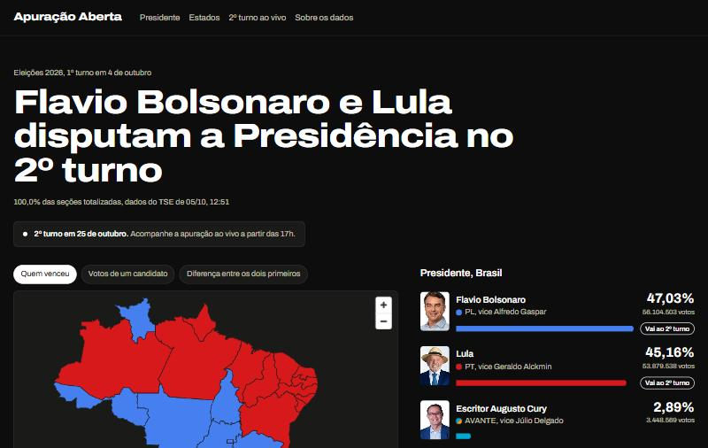
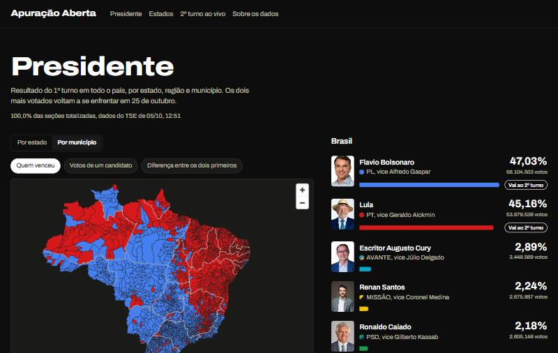
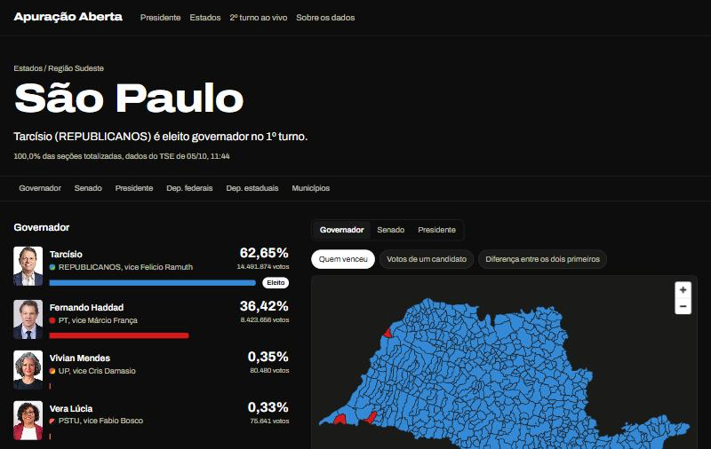
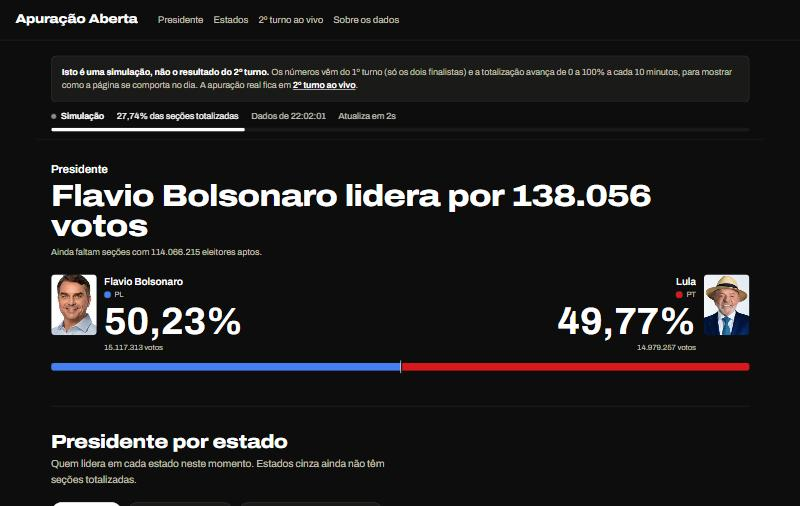

# Apuração Aberta · Eleições 2026

Painel interativo com os resultados oficiais das Eleições Gerais de 2026 no Brasil, do Presidente ao deputado
estadual, em cada estado e em cada um dos 5.571 municípios, com **apuração do 2º turno ao vivo** (25/10/2026).

Todos os números vêm do Tribunal Superior Eleitoral. Projeto pessoal e independente, sem vínculo com o TSE.

<!-- Link do site: preencher após o deploy na Vercel -->



| Presidente por município | Página de um estado |
| --- | --- |
|  |  |



## Uso de IA

Este projeto foi desenvolvido com uso intenso de IA. A maior parte do código foi escrita pelo **Claude Code**, assistente de programação da Anthropic, e todos os commits deste repositório registram essa coautoria.

O que foi meu:

- **Ideia e escopo:** escolhi fazer um painel das Eleições 2026 e defini o que ele deveria mostrar, do Presidente ao deputado estadual, em cada estado e município.
- **Design:** decidi o layout, o conteúdo de cada página e as cores dos partidos.
- **Testes e revisão:** conferi os números, encontrei bugs e pedi as correções.
- **Publicação:** cuido do deploy do site.

O que o Claude Code fez: escreveu a maior parte do código, incluindo o pipeline de dados, os mapas, as páginas, a rota do 2º turno ao vivo e os testes automatizados.

## O que dá para fazer

- **Mapa clicável** do Brasil por estado ou pelos 5.571 municípios, com três leituras: quem venceu, percentual de um
  candidato e diferença entre os dois primeiros. Clique para descer de Brasil para estado e de estado para município.
- **Quem foi para o 2º turno**: Presidente e o mosaico das 27 disputas para governador.
- **Cada estado**: Governador, Senado (2 vagas em 2026), como o estado votou para Presidente e deputados federais e
  estaduais, com cadeiras por partido, votos e vagas por federação, o quociente eleitoral explicado e a lista completa
  de candidatos com busca e filtros por partido e situação (eleito, suplente, não eleito).
- **Cada município**: todos os cargos, inclusive os deputados mais votados na cidade, votos por partido e a lista
  completa de quem teve voto ali.
- **Cada candidato** (cerca de 20 mil): votação, mapa de onde teve mais votos (por estado ou município, também para
  deputados), perfil declarado ao TSE (idade, escolaridade, ocupação, cor/raça) e bens declarados.
- **2º turno ao vivo**: a página se atualiza a cada 5 segundos com os arquivos oficiais do TSE e marca quando a
  vantagem do líder já não pode mais ser alcançada. Há uma simulação em `/ao-vivo/simulacao` para ver o comportamento
  antes do dia.

## Como o projeto foi feito

### 1. Encontrar os dados

O TSE não publica uma API documentada para resultados, mas o próprio site de resultados
(`resultados.tse.jus.br`) é uma aplicação que lê arquivos JSON públicos. Inspecionando esse site, deu para mapear o
formato:

| O quê | Arquivo |
| --- | --- |
| Configuração das eleições | `/oficial/comum/config/ele-c.json` (códigos de 2026: 6257 federal, 6259 estadual; 2º turno 6258/6260) |
| Resultado de um cargo num estado | `/oficial/ele2026/{eleição}/dados/{uf}/{uf}-c{cargo}-e{eleição}-u.json` |
| O mesmo, num município | `.../{uf}{código-TSE-do-município}-c{cargo}-e{eleição}-u.json` |
| Andamento da totalização por município | `.../{uf}-e{eleição}-ab.json` |
| Municípios (código TSE ↔ IBGE) | `/oficial/ele2026/{eleição}/config/mun-e{eleição}-cm.json` |
| Fotos | `/oficial/ele2026/{eleição}/fotos/{uf}/{sq-candidato}.jpeg` |

Os arquivos aceitam CORS, devolvem `ETag` e usam vírgula como separador decimal. Perfil e patrimônio dos candidatos
vêm dos CSV do [Portal de Dados Abertos do TSE](https://dadosabertos.tse.jus.br/) (`consulta_cand_2026`,
`bem_candidato_2026`). O sistema de propostas (DivulgaCandContas) bloqueia acesso automatizado, então as propostas não
foram coletadas por script.

### 2. Pipeline de dados

Scripts em TypeScript (`scripts/`) baixam, validam e normalizam tudo uma vez. O resultado fica em `public/data/` e o
site não depende do TSE para mostrar o 1º turno.

```
build-municipios   lista de municípios com código TSE ↔ IBGE
build-resultados   Brasil, exterior e 27 UFs × 6 cargos            137 arquivos
build-municipal    Presidente, Governador e Senado por município     16.713 consultas ao TSE
build-deputados    deputados federais e estaduais por município     11.142 consultas ao TSE
build-candidatos   perfis e bens (CSV de dados abertos)              20.065 candidatos
build-geo          malhas do IBGE simplificadas em TopoJSON
validate           checagens cruzadas
```

- **Um parser só** (`src/lib/tse/`) serve o pipeline e a rota ao vivo. Os arquivos do TSE passam por schemas `zod`:
  se o formato mudar, o código falha alto em vez de mostrar número errado.
- **Cache em disco** (`.cache/`, fora do git): rodar de novo não baixa tudo outra vez. Os arquivos municipais de
  deputados trazem a lista inteira de candidatos (~300 KB cada), então só a versão compacta é guardada.
- **Validação cruzada** (`npm run data:validate`), que precisa passar inteira:
  - Presidente: soma das 27 UFs + exterior = total nacional, candidato a candidato;
  - soma dos municípios = total de cada UF, para Presidente, Governador, Senado e cada um dos deputados;
  - 2º turno sempre com exatamente dois candidatos;
  - malha cobrindo todos os municípios e endereços (slugs) únicos.

### 3. Mapas

A API de malhas do IBGE ainda não tinha **Boa Esperança do Norte (MT)**, município instalado depois da malha padrão e
que já tem seções eleitorais. A validação pegou a falta, e as malhas passaram a vir do shapefile oficial de 2025 do
IBGE (237 MB). Com o `mapshaper`, o shapefile é simplificado e convertido em TopoJSON: os estados são dissolvidos a
partir dos municípios, então as fronteiras casam. O mapa nacional com 5.571 municípios ficou com 428 KB comprimido e
só carrega quando o usuário pede. Os mapas são desenhados com MapLibre GL, sem mapa de fundo: só as camadas de
dados.

### 4. Site

Next.js (App Router) com páginas estáticas: 7.712 páginas geradas no build (estados, municípios, candidatos
majoritários e deputados eleitos). As outras ~18 mil páginas de candidatos são geradas na primeira visita e ficam em
cache. Os dados de deputados por município são carregados sob demanda, para manter as páginas leves.

### 5. Cores

A interface é monocromática e só os dados têm cor. Cada candidato usa a cor do seu partido (PT vermelho, PL azul,
Missão amarelo e preto, Novo laranja e branco, os demais pela identidade visual do partido), definida num único
arquivo, `src/lib/partidos.ts`. Quando dois candidatos da mesma disputa têm cores parecidas (dois partidos azuis, ou
dois candidatos do mesmo partido ao Senado), o código mede a distância entre as cores no espaço OKLab e usa a cor
secundária do partido ou uma variação mais clara ou escura. No tema escuro, cores muito escuras são clareadas
automaticamente.

### 6. 2º turno ao vivo

```
navegador ── a cada 5 s ──> /api/ao-vivo ── cache de 3 s na CDN da Vercel
                                 │
                                 └── consultas condicionais (ETag) ──> resultados.tse.jus.br (2º turno)
```

- **Poucos segundos de atraso**: o navegador pergunta a cada 5 segundos; a CDN guarda a resposta por 3 segundos,
  então qualquer número de leitores gera no máximo uma rodada de consultas ao TSE a cada 3 segundos.
- **Leve para o TSE**: cada consulta manda o `ETag` da anterior; se o arquivo não mudou, o TSE responde `304` sem
  corpo. No mapa municipal, o arquivo de andamento informa quantas seções cada cidade já totalizou, e só as que
  avançaram são baixadas de novo.
- **Resiliente**: se o TSE falhar ou mudar o formato, a rota devolve o último dado bom e a página avisa que a conexão
  está instável.
- **"Não pode mais ser alcançado"**: aparece quando a vantagem do líder supera o número de eleitores aptos nas seções
  que faltam totalizar. É uma conta, não uma projeção estatística.
- **Sem troca manual**: até o TSE publicar, a página mostra os finalistas e uma contagem regressiva; quando o
  primeiro arquivo aparece, ela passa a mostrar a apuração sozinha.

### 7. Qualidade

- Testes (`vitest`) com arquivos reais do TSE: normalização, totais de federações e partidos isolados, regra do
  "matematicamente definido", URLs e cores dos partidos.
- `tsc` em modo estrito e `oxlint` limpos.
- Layout conferido em 375 px (celular), sem rolagem horizontal, e nos temas claro e escuro.

## Stack

Next.js 16 · React 19 · TypeScript · Tailwind CSS 4 · MapLibre GL · TopoJSON · zod · Vitest · oxlint · mapshaper ·
Vercel

## Estrutura

```
scripts/                 pipeline de dados (build-*.ts) e validação
src/lib/tse/             URLs, schemas e normalização dos arquivos do TSE (+ testes)
src/lib/aovivo/          montagem do painel do 2º turno (oficial e simulação)
src/lib/data/            leitura dos JSON gerados e agregações
src/lib/partidos.ts      cores dos partidos
src/components/          mapa, placares, listas de candidatos, painel ao vivo
src/app/                 páginas e rotas /api/ao-vivo
public/data/             dados gerados (resultados, municípios, deputados, perfis)
public/geo/              malhas em TopoJSON
```

## Rodando localmente

```bash
npm install
npm run dev
```

Os dados já estão no repositório. Para gerar tudo de novo a partir do TSE e do IBGE:

```bash
npm run data             # municípios, resultados, votos por município, deputados, mapas e validação
npm run data:candidatos  # perfis e bens
```

```bash
npm test
npm run typecheck
npm run lint
```

## Propostas de governo

Como o DivulgaCandContas bloqueia acesso automatizado, a página de cada candidato a Presidente e Governador mostra o
link para o sistema do TSE. Para exibir o PDF da proposta dentro do site, basta salvá-lo em
`public/propostas/<SQ_CANDIDATO>.pdf` (o número aparece no endereço da página do candidato).

## Fontes

- [Resultados do TSE](https://resultados.tse.jus.br/oficial/app/index.html)
- [Portal de Dados Abertos do TSE](https://dadosabertos.tse.jus.br/)
- [IBGE, Malhas Territoriais 2025](https://www.ibge.gov.br/geociencias/organizacao-do-territorio/malhas-territoriais/15774-malhas.html)
